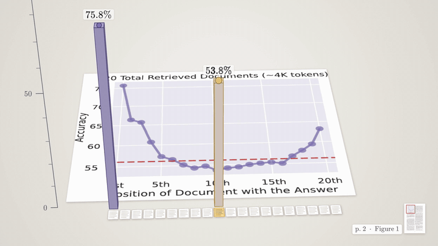
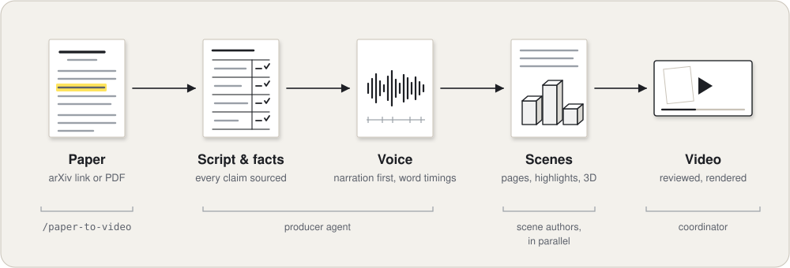
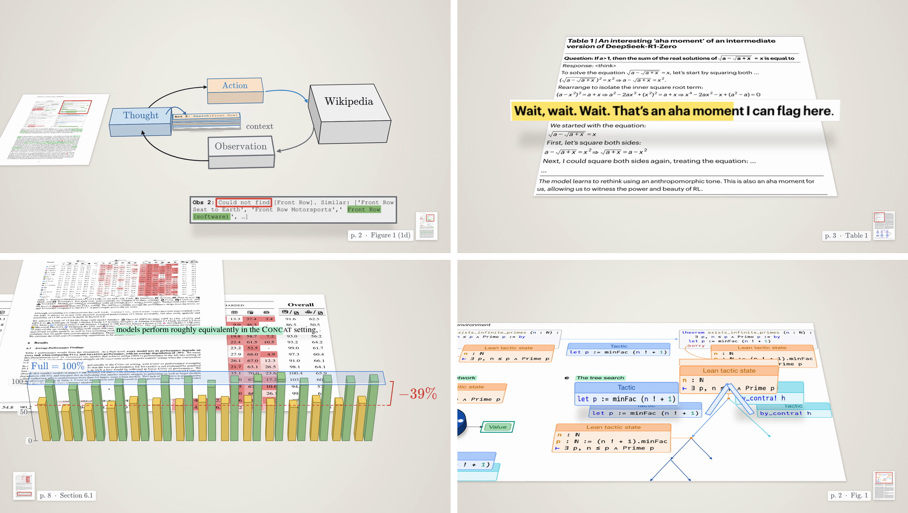

<div align="center">


<h1>Paperframe</h1>

<p><em>Research papers, unfolded into short videos.</em></p>

<p>
<a href="https://github.com/Marcelfedz/paperframe/actions/workflows/ci.yml"></a>
<a href="https://github.com/Marcelfedz/paperframe/releases"></a>
<a href="LICENSE"></a>

<a href="https://claude.com/claude-code"></a>
</p>

<p>
<a href="#quick-start">Quick start</a> ·
<a href="#how-it-works">How it works</a> ·
<a href="#requirements-and-cost">Cost</a> ·
<a href="#commands">Commands</a> ·
<a href="#rights">Rights</a> ·
<a href="#contributing">Contributing</a>
</p>

</div>

---

> **The paper you saved for "this weekend", as a six-minute video with its own pages on screen.**

Paperframe turns a research paper into a narrated, animated video: the real pages on a desk, a highlighter that follows the voice, figures standing up in 3D. Every claim points to its page.

<p align="center">
  
</p>
<p align="center"><sub>Figure 1 of <i>Lost in the Middle</i> (Liu et al., TACL 2024, CC BY 4.0) standing up into 3D. Credits below.</sub></p>

## What you get

- **A 3 to 6 minute video of the paper.** It is narrated, and the paper's own pages are on screen. Every quoted line is highlighted as the voice reads it, and a stamp in the corner always shows which page you are looking at.
- **A script you can check.** A briefing maps every claim to its page, table or figure, and lists what must not be said. The rights decision is written down.
- **Plain files you can edit.** The narration, one prompt per segment and one JavaScript scene per segment are all text. Change a line and re-render.

## Quick start

**1. Install** (macOS or Linux). It checks your tools, installs the engine and the local voice model into `~/paperframe`, and prints the `brew` or `apt` command for anything missing:

```sh
curl -fsSL https://raw.githubusercontent.com/Marcelfedz/paperframe/main/install.sh | sh
```

**2. Open it in [Claude Code](https://claude.com/claude-code):**

```sh
cd ~/paperframe && claude
```

**3. Give it a paper:**

```
/paper-to-video https://arxiv.org/abs/2505.06120 --lite
```

Leave out `--lite` for the full-length video. The finished video lands in `papers/<slug>/out/<slug>.mp4`. Claude Code asks before running commands; allowing `bin/paperframe` for the project saves you most of the prompts.

## How it works

<p align="center">
  
</p>

1. **Paper.** The PDF is turned into page images, plain text and the box of every word, so highlights land on the real line.
2. **Script and facts.** A producer agent reads the paper and writes a briefing: verified facts with their page, guardrails, the rights decision and the segment plan. Then it writes the narration.
3. **Voice.** The narration is spoken first, by [Kokoro](https://github.com/thewh1teagle/kokoro-onnx) running locally, with a timestamp for every word. Everything after this is keyed to those timestamps.
4. **Scenes.** Scene-author agents write one scene per segment in parallel, each a JavaScript function of time drawn on a canvas. They check their work on review stills.
5. **Video.** The coordinator reviews the stills of every segment, then renders the frames with Playwright and joins them with ffmpeg.

The procedure is plain markdown in [`docs/playbook.md`](docs/playbook.md), so any coding agent, or a person, can run it. The visual rules are in [`docs/style-folio.md`](docs/style-folio.md).

## From real videos

<p align="center">
  
</p>
<p align="center"><sub>ReAct · DeepSeek-R1 · LLMs Get Lost in Multi-Turn Conversation · AlphaProof. All CC BY 4.0, credits below.</sub></p>

## Requirements and cost

- **System:** macOS or Linux, with git, Node 20 or later, Python 3.10 or later, ffmpeg and poppler. The installer checks all of them. Windows is untested.
- **Disk:** about 350 MB for the voice model, plus Playwright's Chromium.
- **Claude Code** on your own plan. Paperframe calls no paid API: the voice and the rendering run on your machine. ElevenLabs is an optional paid voice.
- **Tokens:** a full video (8 segments, one producer and four scene authors) measured about **2.3M tokens**. **`--lite`** makes a 4-segment video of about 3 minutes with one producer and one author. It hasn't been measured yet; expect well under half of that. On a Pro plan, start with `--lite`: a full run can hit the usage limit midway. If it does, run the command again later; every stage is saved to disk and the run picks up where it stopped.

## Commands

Everything runs from the repo root. `<video>` is a slug (`papers/<slug>/`) or a path (`examples/react`).

| Command | What it does |
|---|---|
| `bin/paperframe doctor` | Checks every dependency and says how to fix what's missing |
| `bin/paperframe new <slug> <pdf-url> [--pages 1-N]` | Creates `papers/<slug>/` and prepares the paper: page images, word boxes, text |
| `bin/paperframe audio <video> [seg …]` | Narration to speech, with word timings (Kokoro by default) |
| `bin/paperframe stills <video> <seg> [--stills N \| --at t1,t2]` | Review stills and a contact sheet in `review/<seg>/` |
| `bin/paperframe preview <video> <seg>` | Live preview with audio, in your browser |
| `bin/paperframe render <video> [seg\|all] [--workers N]` | Renders segments to `render/` |
| `bin/paperframe assemble <video>` | Joins the segments into `out/<slug>.mp4` and prints chapter marks |

In Claude Code, `/paper-to-video <url> [--lite]` runs all of it. The reference video in [`examples/react/`](examples/react/) shows what every file looks like.

## Rights

The real pages appear in a public video only when the paper's licence allows it. CC BY and CC0 allow it with credit. Most arXiv papers carry arXiv's default licence, which does not. For those, each scene has a one-line switch (`PAGES = false`) that replaces the pages with stand-ins of the same layout and uses redrawn figures. Figures that a paper reprints from someone else are never shown. The source stamp and the end card credit the paper in every video. Details are in the [Rights section of the playbook](docs/playbook.md#rights). It is practical guidance, not legal advice.

This repository never contains paper PDFs, page images, audio or rendered video, apart from the credited README visuals above.

## Contributing

Send a video (its briefing, narration, prompts and scenes, never the pages or audio), improve the kit, or propose a new style. [`CONTRIBUTING.md`](CONTRIBUTING.md) explains how, and the bar a contribution has to clear.

## Credits

Built on [Kokoro](https://huggingface.co/hexgrad/Kokoro-82M) (Apache-2.0) through [kokoro-onnx](https://github.com/thewh1teagle/kokoro-onnx) (MIT), [MathJax](https://www.mathjax.org/) (Apache-2.0), [Playwright](https://playwright.dev/) (Apache-2.0) and [ffmpeg](https://ffmpeg.org/).

README visuals are frames from videos made with Paperframe. All papers are CC BY 4.0 ([licence](https://creativecommons.org/licenses/by/4.0/)), and the pages are shown with highlights, crops and 3D adaptations.

- Hero: Nelson F. Liu, Kevin Lin, John Hewitt, Ashwin Paranjape, Michele Bevilacqua, Fabio Petroni, Percy Liang. "Lost in the Middle: How Language Models Use Long Contexts". *TACL* 12:157–173 (2024). [doi:10.1162/tacl_a_00638](https://doi.org/10.1162/tacl_a_00638). Figure 1, p. 2.
- Stills, top left: Shunyu Yao, Jeffrey Zhao, Dian Yu, Nan Du, Izhak Shafran, Karthik Narasimhan, Yuan Cao. "ReAct: Synergizing Reasoning and Acting in Language Models". ICLR 2023. [arXiv:2210.03629](https://arxiv.org/abs/2210.03629). Figure 1, p. 2.
- Stills, top right: DeepSeek-AI. "DeepSeek-R1 incentivizes reasoning in LLMs through reinforcement learning". *Nature* 645, 633–638 (2025). [doi:10.1038/s41586-025-09422-z](https://doi.org/10.1038/s41586-025-09422-z). Table 1, p. 3.
- Stills, bottom left: Philippe Laban, Hiroaki Hayashi, Yingbo Zhou, Jennifer Neville. "LLMs Get Lost In Multi-Turn Conversation". [arXiv:2505.06120](https://arxiv.org/abs/2505.06120) (2025). Section 6.1, p. 8.
- Stills, bottom right: Thomas Hubert, Rishi Mehta, Laurent Sartran et al. "Olympiad-level formal mathematical reasoning with reinforcement learning". *Nature* 651, 607–613 (2026). [doi:10.1038/s41586-025-09833-y](https://doi.org/10.1038/s41586-025-09833-y). Figure 1, p. 2.

## License

[MIT](LICENSE), © 2026 Marcel Fernández Serrano ([Marcelfedz](https://github.com/Marcelfedz)). Papers shown in videos keep their own licences.
